# Mathematical specification of the MIMIC presets

This page defines the four built-in `MIMIC(mode=...)` presets: `identity`,
`direct`, `factorised`, and `joint`. It describes the default preset
components. Explicit `encoder`, `decoder`, `generation_decode_mode`, and
other constructor arguments can override parts of a preset; see the
[implementation guide](IMPLEMENTATION.md#22-constructor).

The modes are generation and decoding presets. They do not change the
feature-wise prediction problem that supplies MIMIC's learned representations,
except that `identity` uses the preprocessed row itself as its representation.

## Notation and shared setup

Let the modelled data have $p$ columns, indexed by
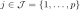. Column $j$ has task type $t_j$, either
regression or classification. Let 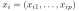 denote row $i$, and
let 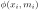 be the globally preprocessed row, including encoded
values and missingness indicators. Here $m_i$ records which values are
missing. Columns declared as ignored are outside 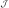.

For the neural presets, the default encoder for target $j$ receives the
preprocessed context with target column $j$ excluded: 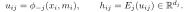

The representation of a row is the concatenation of its feature blocks: 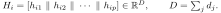

Each encoder is trained as a feature prediction task on rows where its target
is observed. The learned representation is then used to fit a target-specific
decoder. With explicitly configured shared numerical feature groups, encoder
parameters may be shared across those targets; each target still has its own
conditional representation block and target decoder.

Write 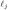 for the task loss: squared error for a regression target
and cross-entropy for a classification target. A target-specific predictive
model is fitted using observed-target rows
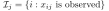. In schematic form: 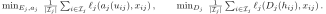

Here $a_j$ is the supervised output head used while learning the neural
encoder; $D_j$ is the fitted feature decoder. These equations specify the
training roles, not a claim that the non-convex neural optimisation reaches a
global minimum.

All non-identity presets use the same default neural encoder and
`NeuralConditionalSampler` decoder family. They differ in how a generated
embedding is decoded. Their default latent generation policy is displacement;
the policy can be replaced independently. The preset mapping is implemented
in [`_preset_components`](https://github.com/fabriziocosta/MIMIC/blob/master/src/mimic/mimic.py#L2122-L2138).

## Identity preset

For each modelled column $j$, the identity encoder receives the full
preprocessed row, including column $j$, and returns it unchanged. With one
feature block per modelled column, the concatenated representation is 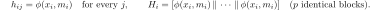

The identity decoder selects the coordinates for its target (for categorical
targets, the corresponding one-hot scores) and maps them back through the
target's output decoding. The repeated blocks multiply all pairwise squared
Euclidean distances by $p$, so they do not change nearest-neighbour ordering.
The preset has no learned feature-wise latent encoder or learned row decoder.
For generation it applies the selected latent-space policy directly in
preprocessed feature space, then decodes the resulting coordinates to the
original column scales and categories.

For continuous values this permits interpolation or displacement in the
preprocessed numeric coordinates. For categorical values, the decoded class is
the class associated with the largest interpolated score. This is a
feature-space baseline; it is not a conditional probability model.

## Direct preset

For each generated embedding , direct
decoding applies each target-specific decoder to that target's own feature
block: 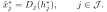

The implementation's neural regression decoder predicts the conditional
mixture mean 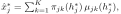

before reversing target scaling. For a categorical target it chooses the
highest-probability class: 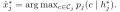

This preset is deterministic at generation time: it returns point predictions
and does not draw values from the conditional samplers.

The target block $h_j$ is itself computed from the input with feature $j$
excluded. Therefore “direct” means direct decoding from the learned
target-specific block; it does not mean that the encoder was given $x_j$.

## Factorised preset

Factorised generation first makes the same deterministic initial decode as the
direct preset. It then performs three ordered passes over the modelled columns.
For each unconditioned column $j$, it forms the fixed context 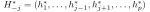

and samples 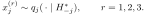

Conditioned columns are kept at their requested values. For a categorical
column, $q_j$ is the fitted conditional class-probability distribution. For
a numerical column, the default neural sampler represents $q_j$ as a
$K$-component Gaussian mixture: 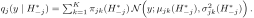

The sampler draws a component according to its mixture weight, then draws a
value from that component. The implementation supports component temperature
and noise scale; their defaults are both one.

The latent context $H^*$ stays fixed through all three passes. Later sampled
column values are not re-encoded and fed back into other conditional samplers.
Consequently these passes are not Gibbs sampling from a joint distribution,
and the conditionals 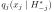 need not be compatible with any
single joint distribution over $x$. Factorised mode is a practical,
feature-wise stochastic decoder.

## Joint preset

Joint mode first computes a conditional-evidence block for every target. For
each $j$, it applies that target's conditional sampler to the other
embedding blocks: $e_j=c_j(H^*_{-j}).$

For a categorical target, $e_j$ is its vector of predicted class
probabilities. For a numerical target, $e_j$ concatenates the predicted
mixture weights, component means, and component scales. The complete evidence
vector is 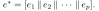

A shared neural trunk 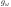 maps $e^*$ to a shared hidden state, and
target-specific heads 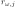 produce all column predictions: 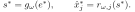

The row decoder is fitted only on complete modelled training rows
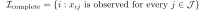.
Its objective is the mean of the per-target losses: 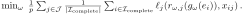

Regression heads use squared error and categorical heads use cross-entropy.
The final predictions are deterministic: regression outputs are inverse-scaled
and categorical outputs use the highest-scoring class.

“Joint” here means **one shared multi-output decoder with a common hidden
representation**. The implementation does not fit a joint density
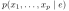, and it does not sample correlated rows from such
a density. The target heads share a learned trunk, while the training loss is
the average of separate per-target losses.

## What is common, and what changes

| Preset | Representation used for generation | Decode rule | Stochastic output sampling |
| --- | --- | --- | --- |
| `identity` | Repeated preprocessed row blocks 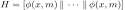 | Identity coordinate decoding | No |
| `direct` | Concatenated target-excluded neural blocks $H$ | $D_j(h_j)$, one head per target | No |
| `factorised` | Same neural blocks $H$ | Initial direct decode, then 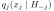 for three passes | Yes |
| `joint` | Same neural blocks $H$ | Shared decoder $G([c_j(H_{-j})]_j)$ | No |

The latent generation policy (for example, interpolation or displacement) is a
separate choice from the decoding preset. For the default displacement policy,
with anchor rows $A,B,C$, the generated embedding is 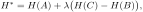

where 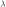 is drawn from the policy's configured interval. In the
default preset configuration the interval is $[0.25,0.75]$, and neighbours
are selected with the mutual-neighbour policy. See the [generation policy
definition](https://github.com/fabriziocosta/MIMIC/blob/master/src/mimic/policies.py#L8-L25)
and the [embedding-generation implementation](https://github.com/fabriziocosta/MIMIC/blob/master/src/mimic/mimic.py#L848-L875).

## Scope and overrides

These equations describe the built-in defaults. A user-supplied encoder or
decoder changes the functions and possibly the loss family. A supplied
`generation_decode_mode` can select a different decoder path from the
`mode` preset. Capacity changes the neural dimensions and optimisation
hyperparameters; it does not change the mathematical input/output structure
above. Explicitly shared numerical feature groups also change parameter sharing
for their encoders. See the
[constructor and preset mapping](IMPLEMENTATION.md#22-constructor) for these
configuration rules.

Implementation references: [feature-wise fitting and decoding](https://github.com/fabriziocosta/MIMIC/blob/master/src/mimic/mimic.py#L640-L661),
[direct and factorised decoding](https://github.com/fabriziocosta/MIMIC/blob/master/src/mimic/mimic.py#L1378-L1410),
[factorised passes](https://github.com/fabriziocosta/MIMIC/blob/master/src/mimic/mimic.py#L1477-L1525),
[joint decoder fitting](https://github.com/fabriziocosta/MIMIC/blob/master/src/mimic/mimic.py#L1412-L1468), and
[neural conditional and joint heads](https://github.com/fabriziocosta/MIMIC/blob/master/src/mimic/decoders.py#L443-L465).
